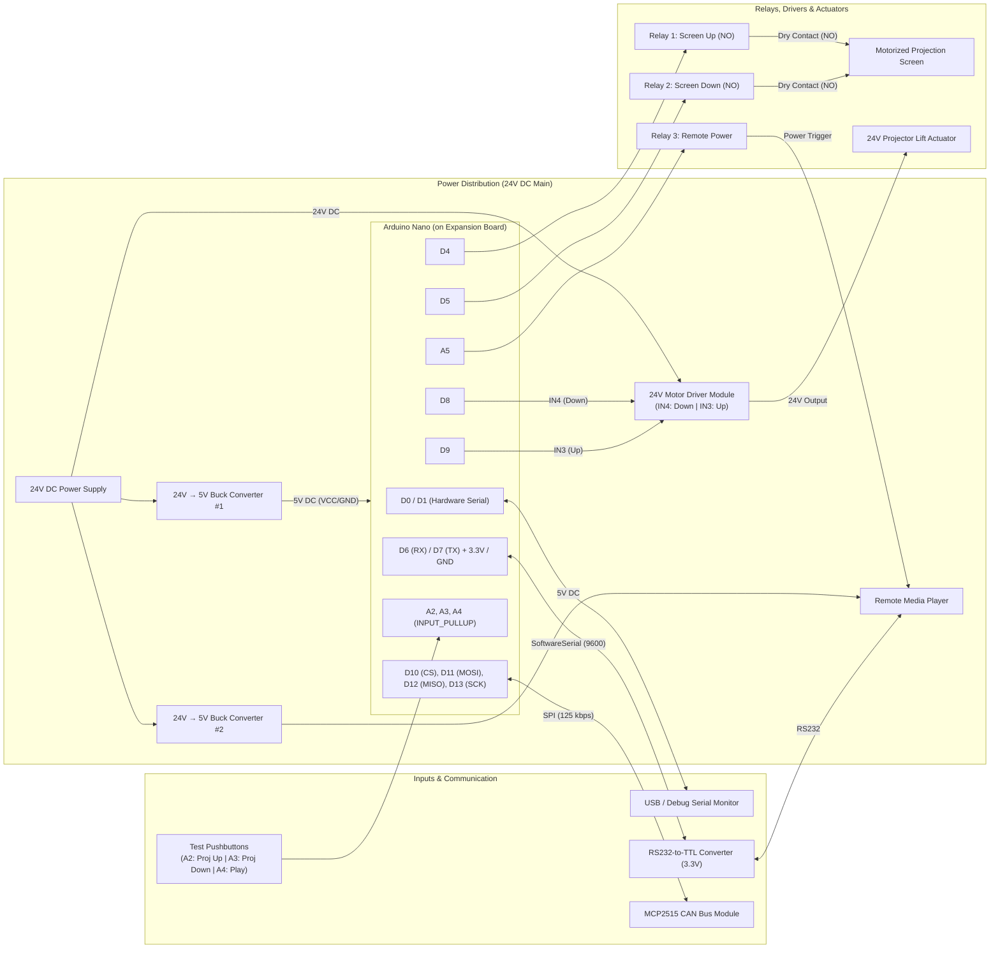

# Arduino-Projector-Controller
An end-to-end project that remotely controls a projector and a motorized screen, syncronized with a remote player, using multiple relays, arduino (MCU), driver module and CAN bus communication module.

## Overview
This system centralizes control over multiple audio-visual devices into a single embedded controller. It accepts both manual physical button inputs and automated network commands over a CAN bus to synchronize motorized screen deployment, projector commands, and audio/media playback.

### Key Features
* **Multi-Protocol Control:** Combines serial communication (**RS232**), network triggers (**CAN bus**), and dry-contact switching (**3-channel relays**).
* **Trio Input Modes:** Supports both remote CAN bus triggers, Serial monitor input and local physical pushbuttons for manual override and testing.
* **Synchronized A/V Sequencing:** Coordinates motorized screen movement, projector power/source states, and remote media player triggers.

---

## Hardware Architecture
* **Microcontroller:** Arduino Nano 
* **Communication Modules:** 
  * CAN Bus Transceiver Module (MCP2515)
  * RS232-to-TTL Serial Converter (MAX3232) 
* **Switching & Actuation:** 3-Channel Relay Module
* **Peripherals & I/O:**
  * Projector (controlled via driver module commands)
  * Motorized Projection Screen (controlled via relay dry contacts)
  * Remote Media Player & Audio Output (controlled via RS232 serial signal)
  * Physical Control Pushbuttons (For testing purpose)
  * Dedicated DC Power Supply

---

## System Wiring & Schematics


## System Wiring & Power Architecture



### Pinout & Power Summary

| Arduino Nano Pin | Connected Module / Circuit | Signal / Function |
| :--- | :--- | :--- |
| `D0` / `D1` | Hardware Serial (USB) | Serial monitor debugging and status logs (`9600 baud`) |
| `D2` / `D3` | *Unconnected* | Reserved from initial bench testing |
| `D4` | Relay Channel 1 (`Screen-Relay-Up`) | Normally Open (NO) dry-contact pulse to raise screen |
| `D5` | Relay Channel 2 (`Screen-Relay-Low`) | Normally Open (NO) dry-contact pulse to lower screen |
| `D6` / `D7` | RS232-to-TTL Converter (`RX` / `TX`) | `SoftwareSerial` commands to remote media player (`3.3V` powered) |
| `D8` | Motor Driver (`IN4`) | Drives 24V linear actuator to lower projector |
| `D9` | Motor Driver (`IN3`) | Drives 24V linear actuator to raise projector |
| `D10` – `D13` | CAN Bus Module (`CS`, `MOSI`, `MISO`, `SCK`) | SPI communication with master controller (`125 kbps`) |
| `A2` / `A3` / `A4` | Physical Test Pushbuttons | Manual overrides: Projector Up (`A2`), Down (`A3`), Play (`A4`) |
| `A5` | Relay Channel 3 (`Power Relay`) | Switches remote power relay for media/projector system |
| `Expansion VCC/GND` | 24V→5V Buck Converter #1 | Dedicated 5V logic supply (isolated from media player's 5V buck) |


### Pinout Summary

| Arduino Nano Pin | Connected Component | Signal / Purpose |
| :--- | :--- | :--- |
| `D2` / `D3` | RS232 Transceiver (TX/RX) | SoftwareSerial commands to projector |
| `D4` – `D6` | 3-Channel Relay Module | Screen Up / Down / Media trigger |
| `D7` – `D8` | Physical Buttons | Manual local control inputs |
| `D10` – `D13` | CAN Bus Module (SPI) | CS, MOSI, MISO, SCK |

*(Update the pin numbers above to match your exact schematic.)*

---

## Firmware & Control Logic
The firmware is written in **C++ (Arduino framework)** and structured around a state-based trigger loop:
1. **Input Polling:** Monitors incoming CAN bus frames and debounced physical button states.
2. **Command Translation:** Maps trigger events to specific RS232 hex/ASCII strings for the projector and digital HIGH/LOW pulses for the relay channels.
3. **Timing & Sequencing:** Manages actuation delays to ensure the motorized screen and audio-visual playback stay synchronized.

---

## Testing & Troubleshooting
To ensure reliable operation in a live environment, the system went through iterative hardware and firmware validation:
* **Serial Verification:** Used a USB-to-RS232 adapter and serial monitor to verify baud rate, parity, and exact command strings before connecting the projector.
* **Electrical Isolation & Continuity:** Checked relay switching states, power rail stability, and ground references with a multimeter to prevent signal noise or voltage drops during motor actuation.
* **Bench Testing:** Simulated CAN bus trigger messages and tested manual pushbutton overrides to verify debounce timing and fault recovery.

---

## Repository Structure
```text
├── src/                  # Arduino C++ source code (.ino / .cpp)
├── diagrams/             # Electrical schematics and wiring diagrams
└── README.md             # Project documentation
```

